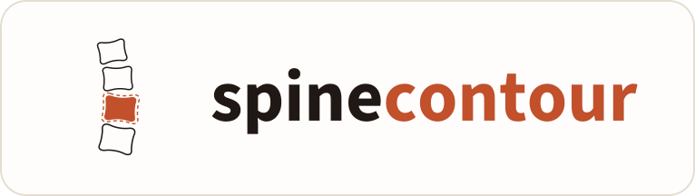

  

<h3 align="center">Spinal alignment, measured automatically.</h3>

  Cervical, lumbar and standing full-spine radiographs, measured in seconds on your own workstation. 
  Open source, free, and nothing ever leaves your computer.

  
  
  

  <a href="https://spine-contour.com/"><b>Website</b></a> ·
  <a href="https://github.com/Feches/Spine-Contour/releases/latest"><b>Download</b></a> ·
  <a href="https://spine-contour.com/guide/"><b>Guide</b></a> ·
  <a href="https://spine-contour.com/#accuracy"><b>Accuracy</b></a> ·
  <a href="CHANGELOG.md"><b>Changelog</b></a>

  

> [!WARNING]
> **Research use only.** SpineContour is investigational software. It is not cleared by any regulator and is not for
> diagnostic or clinical use. Every measurement needs independent verification.

## What it measures

| Film | Measurements |
|---|---|
| **Cervical** | C2–C7 Cobb angle, C2–C7 SVA, 23-point cervical landmarks |
| **Lumbar** | L1–S1 contours and landmarks, lumbar lordosis (L1–S1 and each level to S1), sacral slope, pelvic incidence, pelvic tilt, PI–LL mismatch, L1 pelvic angle, segmental lordosis and disc angulation, anterior / middle / posterior disc heights |
| **Standing full spine** | Global C7–S1 SVA together with every available cervical, lumbar and pelvic parameter |

T1 slope and T4 pelvic angle are reported once T1 or T4 is placed by hand. L1 pelvic angle, T1 slope and T4 pelvic
angle are not yet validated; treat them as exploratory. Results can be reviewed and corrected on the image and exported
as CSV or a PDF report. See [segmental angles](docs/segmental-angles.md), [disc heights](docs/disc-heights.md),
[cervical alignment](docs/cervical-alignment.md) and [global SVA](docs/global-sva.md) for the definitions.

## Accuracy

The models were externally validated on 100 lateral full-spine radiographs from a separate dataset against a
neurosurgery spine fellow's reference measurements: ICC(A,1) 0.998 for global SVA and at least 0.834 across the seven
validated parameters, at about 1.2 s per radiograph on an Apple M2 Max laptop. Details are on the
[website](https://spine-contour.com/#accuracy).

## Local by design

- No upload path, no account or licence server, and no analytics or telemetry.
- Radiographs are read from disk; clinical data comes only from a CSV you choose.
- Exports are written where you choose, and the app works with networking disabled.

## Download

Get the **Windows x64** installer or the **macOS Apple Silicon** disk image from the
[latest release](https://github.com/Feches/Spine-Contour/releases/latest). Each release lists both installers with a
`SHA256SUMS` file. Neither build is code-signed yet: Windows shows a SmartScreen warning, and on macOS Control-click the
app and choose **Open**. Intel Mac builds are not provided. See the [changelog](CHANGELOG.md) and
[release notes](docs/releases/) for what changed. Preview installers are published separately from numbered releases.

## Quick start

1. Open **Studies** and choose a radiograph, or import a whole folder (with an optional clinical-data CSV) through
   **Workspace**.
2. Leave the region on **Auto detect**. It chooses cervical, lumbar or full-spine processing and the image's anterior
   side; both can be overridden on the study or workspace folder, and a film with no detected spine asks you to choose.
   See [automatic film detection](docs/automatic-film-detection.md).
3. **Run segmentation** on one study or a selected batch.
4. Review the landmarks and image scale, correct anything on the image, then export.

To carry films and their annotations to another computer, **Export all** (or **Export N selected**) on the Find tab
writes a bundle folder and **Import bundle…** reads one; see [annotation bundles](docs/bundles.md).

  
  
  
  

## Using the app

<b>Workspace: load a folder and clinical data</b>

It loads a folder of radiographs into the Studies library in one step, with an optional
clinical-data CSV.

- **Choose folder…** scans the folder and its subfolders for `.dcm`, `.dicom`, `.png`, `.jpg`,
  `.jpeg`, `.tif`, `.tiff`, `.bmp` and `.webp` files in any letter case. Other files, links and junctions
  are skipped and counted, as is any subfolder that cannot be read; links are never followed.
- After a scan, card 01 lists every folder that holds films with the **timepoint** and **view** the
  load will assign to the films in it — read off folder names such as `pre-op`, `post-op`, `6wk`,
  `flexion` or `prone`, else `none` and `Standing lateral` — and lets you change any row, or a whole
  column with **Set all…**, before pressing Load. A film's own name is more specific than its folder
  (`S001_preop_flexion.png` sets both), and the first folder below the root that names neither a
  timepoint nor a view is the film's **subject** (`pre-op/S001.png` and `S001/post-op.png` both read
  `S001`). Nothing overwrites a value a film already has; the study's drawer does that.
- **Choose CSV…** (optional) reads a file with one row per study and a `study_id` column. Rows
  join films on the film's filename without its extension, case-insensitively — `SP001.dcm`
  takes the row whose `study_id` is `SP001` or `sp001`. Rows that match no film are counted in
  the load message and not stored; when two rows share a `study_id` the first wins; when two
  films share a stem the row is attached to neither. Four columns are read as study details rather
  than clinical fields: `subject_id` (or `subject`), `timepoint` (or `visit`), `film_date` (or
  `study_date`; `YYYY-MM-DD` or `M/D/YYYY` — a bare `date` column is not read), and `view` (or
  `position`) — a known position such as `flexion` or `standing` is stored as its label. They beat
  what the folder names say.
- Only the nine known clinical fields auto-map — Age, Sex, BMI, Diagnosis, ODI, Treatment plan,
  Surgical history, Follow-up, Notes — by prefix on the column name (`age_yrs` → Age,
  `odi_base` → ODI). Any other column can be mapped from the dropdown on its chip, kept under
  its own name as a custom field (**Keep column name** on the chip, or **Keep N unmapped
  columns** for every remaining one at once — check that none is an identifier first), or left
  unmapped. `study_id` itself is the join key, not a field.
- **Load workspace** adds each new film to Studies as `Unsegmented` and attaches its CSV
  values. Films already in the library (same path) are not added again; the CSV only **fills
  in** clinical fields they are missing and never overwrites a value that is already there
  (use **Import from CSV** on the study's Analysis screen to replace values deliberately).
  Open a study and run segmentation from its Analysis screen; nothing runs automatically. The
  message also says how many films had a subject, timepoint or view read from folder or file
  names or set from the CSV, how many still have no subject or no timepoint, and how many film
  dates could not be read.
- On the Analysis screen the **Clinical data** drawer shows the study's fields. **Import from
  CSV** pulls the matching row from the workspace CSV loaded this session. Values are saved
  with the study; demo studies are not saved and their cells are read-only. The `×` on a
  column head **hides** that column for the session — the values stay on the studies, and the
  column comes back at the next launch if any study still holds a value for it.
- The drawer's **Study** group holds each film's **Subject**, **Timepoint**, **Film date** and
  **View**. Subject is a study code, not a name and not a medical record number — the library is not
  a place for identifiers, and nothing you type there is checked. Timepoint and View suggest the
  labels the app knows (`Pre-op`, `Intra-op`, `Post-op`, `6 wk`, `1 yr`, `2 yr`; the five lateral
  positions); a known position or label is stored as its label, anything else is kept as typed.
  **Import from CSV** also brings these four in when the CSV has the columns.
- Deleting a study from the Studies list removes its record and its saved segmentation
  (`predictions/<id>.json` in the app's data folder). The film on disk is not touched.

The app's own **Export CSV** file cannot be loaded back in through the Workspace. Three separate
things stop it, and `docs/ROADMAP.md` (item 1) sets out each of them and the design decision a
fix has to make first.

<b>Parameters tab and CSV export</b>

The Studies screen has two tabs. **Find** is the list. **Parameters** shows every segmented study's
measurements in one grid — subject, timepoint, view and film date, then PI, PT, SS, LL L1–S1, PI–LL,
L1PA, the L2–S1…L5–S1 levels behind a **Levels** toggle, any clinical fields in use, and the
workspace and folder each film came from.

- Filter by workspace, by folder within it, by timepoint (including films with none), by view, by a
  subject substring, and **Paired only** (subjects with a Pre-op film and, by default, any other
  labelled film — **All paired**; pick a label in the `with` dropdown to narrow to that visit), and by
  **Segmented only** (on by default; the note beside it says how many unsegmented films are hidden).
  The search box applies to the grid as well as the list. Click a column header to sort; absent
  values sort last. Sorting by **Subject** groups each subject's films, Pre-op first, with a rule
  between subjects.
- Click a study name to open it. Tick rows to choose a subset: the button reads **Export N selected**
  and writes the ticked rows that are visible; with nothing ticked, **Export CSV** writes every
  visible row. Hidden picks stay ticked and return with the filter.
- The file has two `#` comment lines, then the header
  `Study ID,View,Subject,Timepoint,Film date,LL L1-S1,PI,PT,SS,PI-LL Mismatch,L1PA,LL L2-S1,LL L3-S1,LL L4-S1,LL L5-S1`
  followed by 15 calibrated disc-height columns, every clinical field present on the exported studies,
  and calibration metadata when present. Absent values are empty cells. Demo
  studies are never exported.
- **Export paired CSV** writes one row per subject over the same rows: `Subject`, then every visit's `<label> study`,
  then every visit's `<label> view`, then every visit's `<label> film date` (`Pre-op` first within each kind, then
  every later timepoint present — Intra-op, Post-op, then durations by length, then other labels), then for each
  measurement `<M> Pre-op`, `<M> <label>` and `Delta <M> <label>` (the later value minus the Pre-op value over the
  values as written; empty when either is absent), then each clinical field per visit. A subject needs exactly one
  Pre-op film and one film per later visit it has; a subject with two films on one visit is left out and named in the
  message, as are subjects with no pair; films with no subject and films with no timepoint are counted. With **Paired
  only** ticked and a label chosen in `with`, the file has that visit only and the message counts the films of other
  visits it left out. Suggested name `<workspace>-paired.csv`.

<b>Image and folder calibration</b>

If automatic image calibration fails, open **Image calibration**, draw the two reference endpoints, enter the known
length in millimetres and click **Apply reference**. Wait for **Reference saved for this image**. That scale is retained
across restarts and used for disc heights after segmentation, including when the reference was saved before loading the
workspace.

Choosing an image folder in **Workspace** automatically checks every image for a printed ruler or DICOM pixel spacing. No reference teaching is required. Select **Continue to workspace** when the scan finishes, or **Skip for now** to stop and keep completed results. Missing, ambiguous and conflicting references remain uncalibrated and do not block segmentation.

Single and batch segmentation also calibrate each original image automatically, including rulers outside the lumbar crop. Results are saved in each study and its prediction sidecar: reference endpoints, printed value, pixel length, mm/pixel, detection status and source. The Measurements panel shows **Image scale** with **Review image scale** to reopen the original film. CSV and paired CSV exports append per-film calibration columns when calibration results are present; unknown scales are blank. The Measurements panel and both CSV formats also include anterior, middle and posterior disc heights for L1–L2 through L5–S1, in millimetres. They use anterior-to-anterior and posterior-to-posterior keypoint distances across the facing endplates, plus the distance between the two endplate midpoints. Missing scale or invalid endplates leave that level blank. Paired exports include changes from pre-op. See [disc-height definitions](docs/disc-heights.md). Angular measurements are unchanged.

In **Image calibration**, green points mark the reference. Drag either endpoint, correct the length in millimeters, then select **Apply reference**. **Measure distance** places two yellow points and displays their distance using that scale. Corrections to loaded studies persist across restarts and reruns. Cached results are reused only when a SHA-256 digest matches the exact source file; replacing a file at the same path triggers a fresh check. Images reviewed before **Load workspace** retain their compact results in the session and receive them when studies are created.

**Use reference appearance for folder** is optional: it learns the corrected shaft's foreground color to supplement automatic detection. **Process folder** retries detection while preserving manual corrections. Each image uses its own reference length and pixel spacing. **Save calibration results** exports the detection profile and per-image references as JSON. Saved profile import is not implemented.

DICOM `PixelSpacing` preserves row and column spacing; detector-plane spacing is not silently substituted. Screenshot scale is derived from the printed annotation, not independently corrected for projection magnification. Capped straight rulers are supported; arrows, graduated scales and angle markers are not yet supported. Manual reference placement remains available when automatic OCR fails. Production and preview installers bundle Tesseract; development on macOS needs `brew install tesseract`.

<b>Processing settings: toolbar removal, low memory, GPU</b>

**Settings → Processing → Toolbar removal** can remove detected bottom PACS
toolbars from screenshots before segmentation. It uses fast image checks, works
with Crop localizer On or Off, and applies to the next single-image or batch run.
It defaults to Off. Uncertain images and native high-bit-depth/DICOM images are
kept unchanged. The source file and original-image calibration are preserved.
See [toolbar removal](docs/toolbar-removal.md) for supported strips and validation.

Open **Settings → Processing → Low memory**. This processes one search region at a
time, keeps only the current model loaded, and allows longer calibration OCR waits.
Choose 1–4 CPU threads (2 by default) to leave more capacity for other work. The
choice is saved for the next launch. Model resolution and the selected crop-localizer
behavior are retained; this mode can take longer and still needs enough memory for one model.

Processing shows the actual stage, completed search regions or OCR passes, and elapsed
time. **Cancel processing** cancels the current image and stops a running batch;
**Stop** on the batch bar finishes the current image first. Completed studies and
previous results from a cancelled re-run are kept. Cancellation takes effect between
operations; a model call or OCR pass already executing must finish first.

See [processing modes and validation](docs/low-memory-processing.md).

**GPU processing.** **Settings → Processing → Processor** runs the models on a GPU instead of the CPU.
On Windows it lists each DirectX 12 graphics card — NVIDIA, AMD or Intel — by name;
nothing else needs installing. A GPU chosen for the app in Windows graphics settings
or the NVIDIA app does not affect processing; only this setting does. The CPU stays
the default. A model the GPU cannot run falls back to the CPU, and each result's
Analysis header says whether it ran on the **GPU**, the **CPU** or both. macOS runs on
the CPU. See [GPU processing](docs/gpu-processing.md).

<b>Models</b>

Three structures are read from a lateral film — the L1–L5 vertebral bodies, the S1 endplate, and the femoral heads —
and **Settings** in the sidebar shows which model reads each. The femoral heads and the S1 endplate each have one. The
vertebral bodies have two, and the choice applies to the next run:

- **U-Net** segments each body and reads its corners off the mask.
- **HRNet** regresses each corner directly. It can place a corner where a mask has no pixels. Because it predicts every
  level even on a cropped film, a U-Net mask checks which levels have body evidence before their HRNet corners are
  retained. Invalid or off-film quadrilaterals are omitted.

Each study's Analysis header names the model that produced the numbers on screen, and the saved result records it, so a
library measured with both can still be told apart.

The trained models run locally through **ONNX Runtime** with float32 weights; no quantization is applied. The HRNet
landmark model, the S1 detector and the anatomical cervical HRNet carry fine-tuned weights, and the anatomical cervical
HRNet also reads the neck on full-spine films. The U-Net vertebral model and the femoral U-Net keep their original
weights.

**Settings → Processing → Crop localizer** is On by default. For **lumbar-only images** already framed around the
anatomy, turn it Off to skip the crop search and process the supplied image once; S1, vertebrae and femoral heads are
still detected. Off keeps the visible image extent, with quick cleanup of broad empty screenshot borders. The choice is
saved and applies to the next run or batch; it changes the model input and may change detected anatomy, so review the
result. The runtime, localizer setting and selected frame are recorded with each result.

See [inference implementation and validation](docs/onnx-inference.md).

<b>Partial segmentation</b>

A film does not need to contain every structure. If only L1 is detected, its mask
and landmarks remain available for review and correction. Missing levels are not
renumbered. If S1 cannot anchor a crop, inference falls back to the image extent,
trimming broad near-black screenshot margins when present.

Partial results are saved as **Needs review**, with the missing structures listed.
Batch processing keeps them and continues to the next film. Each measurement uses
only its required landmarks: sacral slope needs S1; each level-to-S1 lordosis needs
that level and S1; PI/PT need S1 and the hip axis; L1PA also needs L1. A rejected
femoral fit leaves independent spine measurements available. Missing inputs display
`—` and export as empty cells, including paired changes.

Disc heights require both facing endplates and a valid image scale. If S1 is absent,
U-Net cannot establish anterior/posterior orientation: the midpoint height can still
be measured for a detected adjacent pair, while anterior/posterior heights stay blank.
The detector can still misidentify levels or miss visible anatomy; review the result.
An image with no usable landmarks still reports an error. See [partial segmentation](docs/partial-segmentation.md).

<b>Clear the study library</b>

On **Studies**, select **Delete all studies**, then confirm the displayed count. This clears every study, including entries hidden by search, plus saved segmentation results; in a development build that includes the demo studies (a packaged build has none). Original radiograph files are kept. Demo studies remain hidden after restarting. The action is unavailable during segmentation or when the saved library cannot safely be written. If a saved result cannot be deleted, its study remains in the library and the app reports the failure.

## Documentation

| Topic | |
|---|---|
| Region and orientation detection | [automatic-film-detection.md](docs/automatic-film-detection.md) |
| Cervical and global alignment | [cervical-alignment.md](docs/cervical-alignment.md) · [global-sva.md](docs/global-sva.md) |
| Measurement definitions | [segmental-angles.md](docs/segmental-angles.md) · [disc-heights.md](docs/disc-heights.md) |
| Calibration | [batch-calibration.md](docs/batch-calibration.md) · [manual-calibration-persistence.md](docs/manual-calibration-persistence.md) |
| Processing | [onnx-inference.md](docs/onnx-inference.md) · [gpu-processing.md](docs/gpu-processing.md) · [low-memory-processing.md](docs/low-memory-processing.md) · [toolbar-removal.md](docs/toolbar-removal.md) |
| Results and data | [partial-segmentation.md](docs/partial-segmentation.md) · [bundles.md](docs/bundles.md) · [naming-films.md](docs/naming-films.md) |
| Releases | [CHANGELOG.md](CHANGELOG.md) · [release-main.md](docs/release-main.md) · [release-preview.md](docs/release-preview.md) · [ROADMAP.md](docs/ROADMAP.md) |

## Test data

No radiograph ships with the app or the installer. Test with your own de-identified lateral films, or with a public
dataset:

| Dataset | Paper | Data |
|---|---|---|
| BUU-LSPINE | [Applied Sciences](https://www.mdpi.com/2076-3417/13/15/8646) | [dataset](https://services.informatics.buu.ac.th/spine/) |
| VinDr-SpineXR | [arXiv](https://arxiv.org/abs/2106.12930) | [PhysioNet](https://physionet.org/content/vindr-spinexr/1.0.0/) |
| CSXA | [Scientific Data](https://www.nature.com/articles/s41597-024-03383-0) | [ScienceDB](https://www.scidb.cn/en/detail?dataSetId=8e3b3d5e60a348ba961e19d48b881c90) |
| Merlin | [arXiv](https://arxiv.org/abs/2406.06512) | see the paper |

Each dataset has its own access terms and licence; check them before use. None is bundled with, or endorsed by, this
project.

## Contact

Questions and feedback: [spine-contour@gmail.com](mailto:spine-contour@gmail.com).

## License

Copyright (C) 2026 Cody Woodhouse and Michael Jayasuriya

This program is free software: you can redistribute it and/or modify
it under the terms of the GNU Affero General Public License as published by
the Free Software Foundation, either version 3 of the License, or
(at your option) any later version.

This program is distributed in the hope that it will be useful,
but WITHOUT ANY WARRANTY; without even the implied warranty of
MERCHANTABILITY or FITNESS FOR A PARTICULAR PURPOSE.  See the
GNU Affero General Public License for more details.

You should have received a copy of the GNU Affero General Public License
along with this program.  If not, see <https://www.gnu.org/licenses/>.
