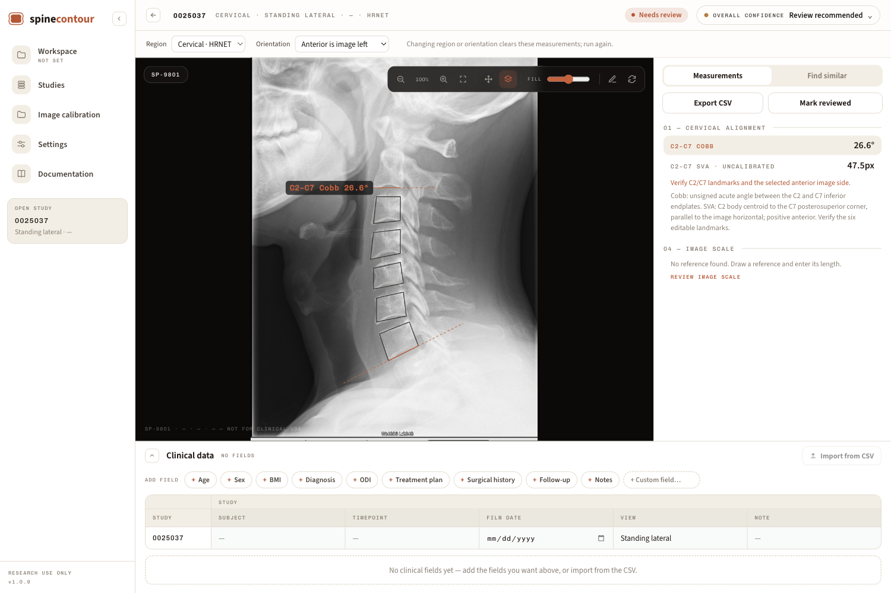
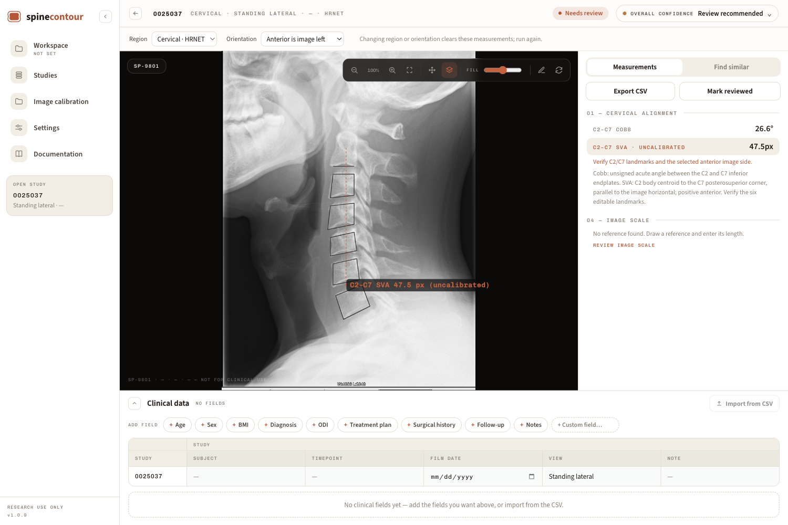

# Cervical alignment

Select **Cervical** for the study or its workspace folder, or use automatic region
selection. The cervical model predicts anatomically named anterior and posterior
corners in either image orientation. Anterior side is inferred from the predicted
endplates. The cervical UI has no manual orientation selector. The API retains an explicit side override for compatibility,
without exchanging anatomical landmark identities. A disagreement is flagged for review.

Run the model, review the landmarks on the source image, and select a measurement
row to display its construction. The available endplate corners and C2 centroid can be corrected;
the measurements recalculate and the corrected geometry is saved with the study.
Reset restores the original prediction. Cervical results are included in the
Parameters table and CSV exports. A missing anchor leaves its dependent value
absent. The cervical model reads the whole radiograph without a crop detector.

Segmental lordosis and disc angulation are also available; see [segmental angles](segmental-angles.md).

## Definitions and scale

- **C2–C7 Cobb:** the unsigned acute angle between the C2 inferior endplate and
  C7 inferior endplate. It does not use the C7 superior endplate and does not
  assign a lordosis/kyphosis sign.
- **C2–C7 SVA:** horizontal displacement of the C2 body centroid relative to the
  C7 superior-posterior corner. Positive means anterior displacement, according
  to the inferred anterior side. The plumb line follows image acquisition
  vertical; the pipeline does not rotate the spine upright.

Without valid calibration, SVA is explicitly shown in pixels and its millimetre
value remains absent. With calibration, column spacing converts horizontal SVA
and both row and column spacing determine the physical endplate angles. A manual
scale correction or clear updates the displayed/exported measurements immediately;
old scale values in a prediction cannot override the current calibration. Detector
pixel spacing is not silently substituted for DICOM `PixelSpacing`; source
provenance remains attached to the calibration.

The model estimates landmarks; it does not establish that obscured cortex is
visible. Review C2 identity, C7 coverage, and each required cortical corner before
accepting the measurements. The cervical pipeline returns no segmentation masks.

## Model provenance

The anatomical HRNet-W32 model predicts 23 channels: C2 centroid and inferior
anterior/posterior corners, followed by superior and inferior anterior/posterior
corners for C3–C7. The bundled fine-tuned checkpoint is epoch 16, identified by
its SHA-256 in the ONNX sidecar. Checkpoint selection and export parity do not
establish held-out anatomical accuracy.

Input is an aspect-preserving grayscale letterbox of 384×512 pixels, with
ImageNet normalization. The 96×128 heatmap argmax coordinates are multiplied by
four, unpadded and divided by the resize scale to recover source-image coordinates.
The ONNX sidecar records the checkpoint hash, epoch, channel names, preprocessing
and real-image export parity checks. No cervical segmentation masks are generated.

## Development and packaging

```sh
git lfs pull
python -m pip install -r backend/requirements-export.txt
python tools/export_onnx.py
python -m pytest backend/tests -q
node --test test/*.test.js
```

Export the anatomical cervical model with real-image parity checks:

```sh
python tools/export_cervical_anatomical_onnx.py --checkpoint /path/to/best.pt --image /path/to/cervical.png
```

Standalone cervical inference and full-spine cervical crops use the same
anatomical checkpoint. Full-spine crops retain the standing-film search and
consensus checks; reflections preserve anterior/posterior channel identities.
The legacy exporter remains available for older model assets. Generated ONNX files and sidecars are stored under `backend/onnx/`.
The desktop runtime remains ONNX-only; PyTorch and timm are build dependencies.
Coordinate-contract regression tests and real-image inference checks are distinct
from anatomical accuracy evaluation.

With an isolated scratch-profile app running, repeat the desktop check using:

```sh
CDP_PORT=9246 node tools/smoke/smoke-cervical.mjs /path/to/cervical-test-image.png
```

The test image must face anterior to image left. The check applies a deliberately
synthetic scale to its scratch study; its output is not a clinical measurement.

## Sample desktop output

The screenshots below show HRNET running on CSXA test image `0025037.png`, with
anterior on image left. The predicted C2–C7 Cobb angle is **26.6°**, and signed
C2–C7 SVA is **47.5 px**. No physical scale is available for this PNG, so SVA is
explicitly uncalibrated. These are model predictions for review.





A complete bundle export uses `tools/export_onnx.py --cervical-checkpoint CHECKPOINT --cervical-image RADIOGRAPH` (repeat the image option for additional parity cases). The checkpoint and real-image arguments are required so a complete export cannot silently omit the anatomical cervical model.

For standing films with established cervical crop consensus but unresolved lumbar orientation, the anatomical model checks that cervical crop in both image orientations. Orientation is accepted only when the reflected anatomical endpoints agree with each other and with the established crop landmarks. Unresolved or missing anatomy still withholds orientation; this fallback does not create lumbar landmarks or a segmentation mask.
