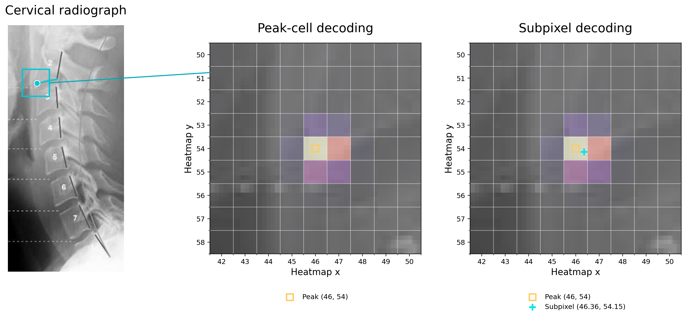

# Fixed measurement pipeline

The production configuration is defined by `backend/pipeline_stages.py` and
`backend/fixed_pipeline.py`. Stage replacement is a code/configuration change;
users do not select experimental combinations in the application.

| Measurements | Predictor | Decoder | Lumbar candidate policy |
| --- | --- | --- | --- |
| C2–C7 Cobb, C2–C7 SVA | Fine-tuned anatomical cervical HRNet, annotation-focused epoch 16 | 9×9 local softmax, temperature 12 | Automatic neck crop |
| Global SVA | Fine-tuned cervical HRNet, annotation-focused epoch 16; lumbar HRNet, epoch 1 | Original | Original and 15% upward extension |
| L1–S1 lordosis, sacral slope, pelvic incidence | Fine-tuned lumbar HRNet, epoch 1 | 9×9 local softmax, temperature 12 | Every candidate extended upward 15% |
| Pelvic tilt | Fine-tuned lumbar HRNet, epoch 1 | 9×9 local softmax, temperature 12 | Original and 15% upward extension |

Pelvic measurements use the conservative femoral U-Net checkpoint. S1 localization
and corroboration use the fine-tuned Keypoint R-CNN with local subpixel decoding. Existing cervical localization
uses DETR and image-sided HRNet crop agreement. The optional learned region detector is fine-tuned on 611 region-labeled images.
The default search-based localization route remains unchanged. Training data,
validation and checkpoint selection are documented in [annotated fine-tuning](annotated-finetuning.md).

## Stage contracts

`Stages` supplies replaceable lumbar and cervical locators, cervical candidate
generation, S1 detection, femoral segmentation, predictor graph identifiers,
and explicit decoder callables.
Lumbar locators receive a grayscale image in canonical anterior-left orientation
and return a crop record with a `window` or `None`. Rectangles use half-open
`left, top, right, bottom` pixel coordinates. Cervical regional locators return
an original-image rectangle. Model coordinates are restored once, before
measurement. No stage receives reader measurements or reference landmarks.

`measurement_sources` retains the distinct global-SVA and pelvic-tilt anchors.
The viewer and measurement service select the same source. Human changes to
shared S1/hip/C7 anchors supersede the affected automatic source; reset restores
the complete original geometry. Source-image scale is supplied independently.

## Application runtime

The desktop uses the CPU or the existing Windows DirectML processor selection.
S1 detection and HRNet crop candidates run one image per inference call. The
session cache is bounded to four models, and low-memory mode releases models
between stages. GPU qualification and whole-film CPU fallback retain the
pre-existing DirectML behavior.

The Windows preview uses the same DirectML runtime and installer format as
before the model update. The separate CUDA preview, adaptive crop batches,
four-image S1 graph and GPU allocation retries are removed. Fine-tuned weights,
landmark decoders and measurement routes are unchanged.

## Reproduction

`tools/reproduce_fixed_pipeline.py` runs the application stages on a private
manifest, checks image hashes and saves geometry, provenance and timings.
Frozen-localization and `--fresh` runs are distinct. Expected workbook values
are read only by `tools/compare_fixed_pipeline.py`, after inference. The default
comparison requires identical missing-value availability and a maximum absolute
difference of 0.1 degrees or millimetres. Calibration is an explicit input;
using frozen scale does not validate automatic ruler extraction. Exact reproduction
requires matching checkpoint hashes. Comparisons between the fine-tuned models
and the reference workbook describe changed predictions, not reader accuracy.

## Subpixel decoding

Radiograph adapted from Haas et al., Figure 2B, [PMC11084776](https://pmc.ncbi.nlm.nih.gov/articles/PMC11084776/), [CC BY 4.0](https://creativecommons.org/licenses/by/4.0/). Original publication annotations remain visible. The heatmap and cyan landmark come from the cervical model applied to this cropped panel; both decoding methods use the same heatmap.

Peak-cell decoding selects the strongest grid position. Subpixel decoding takes a weighted average within its 9 × 9 neighborhood, using softmax weights `exp(12 × heatmap value)`. Here the C2 landmark moves from **(46, 54)** to **(46.36, 54.15)** in heatmap coordinates. The position can fall between grid centers.

The decoded points are mapped back to the radiograph before calculating Cobb angle and SVA. The measurement definitions and comparison against reference measurements stay the same. This example illustrates the coordinate change; it does not establish that this individual prediction is more accurate. Source and model hashes are recorded in `images/subpixel-decoding.json`.

## Model storage

The unused lumbar segmentation checkpoint and regional segmentation API are removed. This saves 97.9 MB against the earlier PR and prevents the obsolete ONNX graph from entering rebuilt packages. Tracked model assets total 1,363.8 MB, compared with 983.5 MB on the base branch. The required subpixel and batched exports still increase net storage. These figures exclude Git history, installed dependencies and installer compression.

The cervical localization HRNet remains active in crop selection. It is distinct from the cervical measurement HRNets; removing it would change localization rather than remove an unused model.
